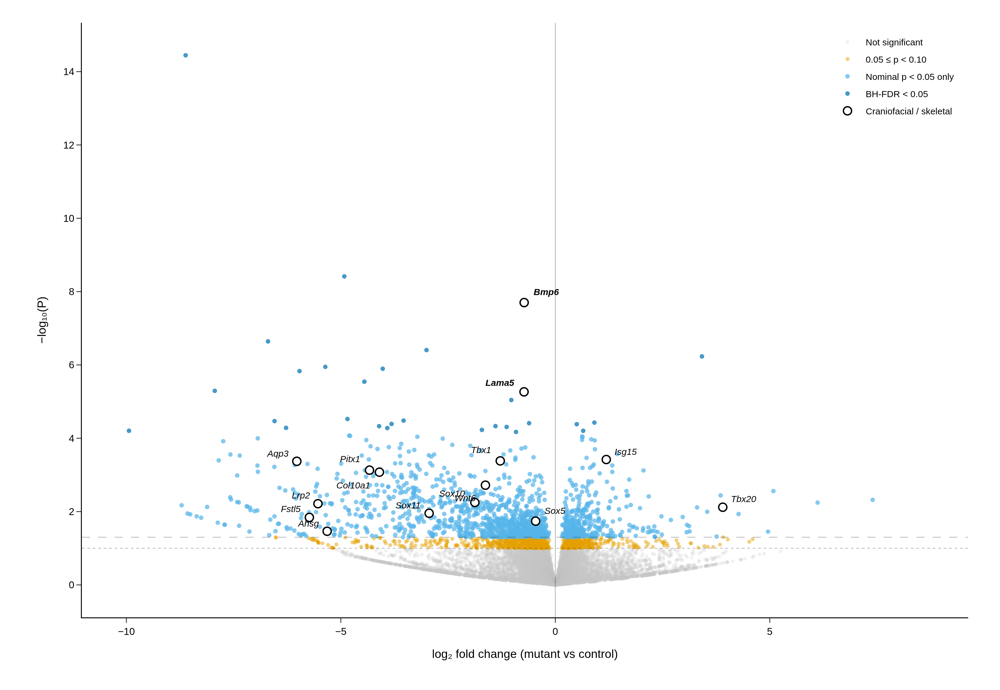
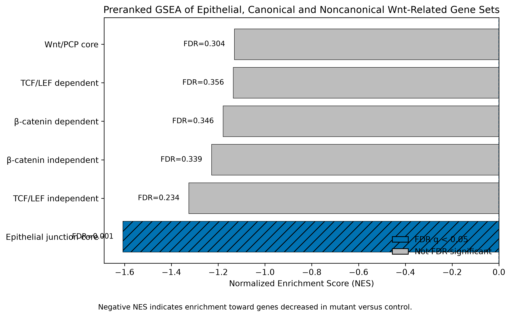
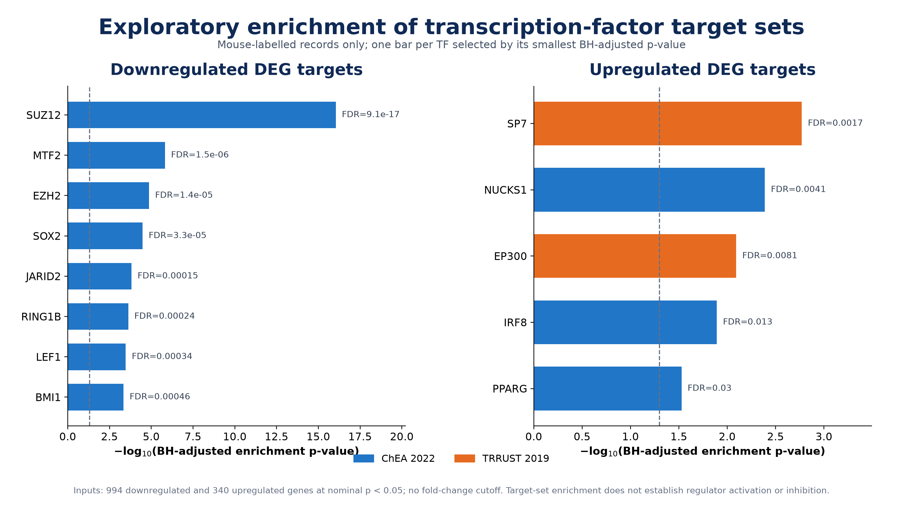

# Wnt/β-Catenin Transcriptomic Analysis in Mouse Mutant Tissue

[](https://www.python.org/)
[](https://bioconductor.org/packages/DESeq2/)
[](#statistical-limitations)
[](#license)

A reproducible exploratory analysis of bulk RNA-seq differential-expression
results from mouse mutant tissue, emphasizing epithelial integrity,
craniofacial and skeletal development, canonical and noncanonical Wnt
signaling, and transcription-factor target-set enrichment.

## Experimental design

| Group | Biological replicates |
|---|---:|
| Control | 4 |
| Mutant | 4 |

Canonical input:

```text
data/processed/DESeq2_results_RECALCULATE_4control_4mutant-20251023_TM.csv
```

| Measure | Count |
|---|---:|
| Raw rows | 22,444 |
| Rows with usable symbol, fold change, and p-value | 21,730 |
| Unique analyzed gene symbols | 21,715 |

The supplied table contains `gene_id`, `symbol`, `baseMean`,
`log2FoldChange`, and nominal `pvalue`. It does not contain the original
DESeq2 `padj` column.

## Principal validated results

### Differential expression

Using nominal `p < 0.05` and `|log2FoldChange| >= 1`:

| Category | Genes |
|---|---:|
| Upregulated | 84 |
| Downregulated | 661 |
| Total | 745 |

A stricter exploratory filter of nominal `p < 0.01` and
`|log2FoldChange| > 2` identifies 249 genes: 10 upregulated and 239
downregulated.

### Epithelial-junction program

Custom preranked GSEA identified strong negative enrichment of the
exploratory epithelial-junction core set:

- NES: approximately -1.61
- GSEA FDR q-value: approximately 0.0012
- Direction: enrichment toward genes decreased in mutant versus control

Leading-edge genes include epithelial keratins, desmosomal genes, claudins,
and other junction-associated genes.

### Literature-derived Wnt signatures

Four gene sets from the supplied Wnt/TCF signature workbook were analyzed:

- β-catenin dependent
- β-catenin independent
- TCF/LEF dependent
- TCF/LEF independent

None reached FDR significance in the custom preranked GSEA. Their negative
NES values are exploratory trends and should not be described as confirmed
pathway suppression.

### Broad pathway GSEA

GO Biological Process 2023, Reactome 2022, and KEGG 2026 were evaluated
separately using preranked GSEA.

- Pathways tested after size filtering: 5,057
- Pathways reaching within-library FDR q-value `< 0.05`: 0

Several epithelial, junction, adhesion, and keratinization pathways showed
negative nominal trends, but none survived within-library FDR correction.

### Craniofacial and skeletal screen

An ontology-driven keyword framework selected:

| Measure | Count |
|---|---:|
| Unique selected GO terms | 44 |
| GO-derived candidate-gene universe | 496 |
| Candidate genes detected in RNA-seq | 453 |

Two craniofacial/skeletal genes passed the project's audit-derived BH
threshold: `Bmp6` and `Lama5`.

The canonical Wnt reference genes `Axin2`, `Dkk1`, `Nkd1`, `Tcf7`,
`Apcdd1`, and `Sp5` were not significant.

### Upstream TF-target enrichment

Nominal DEGs were separated by direction using `p < 0.05` with no
fold-change cutoff:

| Input | Genes |
|---|---:|
| Downregulated | 994 |
| Upregulated | 340 |

Target-set enrichment was performed through Enrichr using TRRUST
Transcription Factors 2019 and ChEA 2022. The output contained 72
significant downregulated-target records and 5 significant
upregulated-target records at adjusted enrichment `p < 0.05`. No regulator
was significant in both databases.

This analysis identifies enriched transcription-factor target sets. It does
not prove that a transcription factor is activated, inhibited, causal, or
physically upstream in this experiment.

## Analysis workflow

| Script | Purpose |
|---|---|
| `01_parse_degs.py` | Create direction-specific DEG tables |
| `02_volcano_plot.py` | Generate the basic transcriptome volcano plot |
| `03_pathway_enrichment.py` | DEG over-representation analysis |
| `04_wnt_signature_analysis.py` | Fisher tests for four Wnt/TCF signatures |
| `04b_strict_deg_filter.py` | Generate the strict exploratory DEG subset |
| `05_wnt_ranked_gsea.py` | Custom Wnt and epithelial preranked GSEA |
| `06_gsea_summary_plot.py` | Plot custom GSEA NES values |
| `07_pathway_preranked_gsea.py` | Broad GO, Reactome, and KEGG GSEA |
| `08_wnt_pcp_mechanistic_interrogation.py` | Extract exploratory mechanistic themes |
| `09_mechanistic_summary_figure.py` | Visualize the FDR-significant pathway fraction |
| `10_mechanistic_driver_table.py` | Create non-causal significant-pathway tables |
| `11_craniofacial_skeletal_extraction.py` | Build the GO-derived developmental screen |
| `12_nature_craniofacial_volcano.py` | Generate the clean craniofacial volcano figure |
| `13_upstream_tf_target_enrichment.py` | Run audited TF-target enrichment |

## Reproduction

Run all commands from the repository root.

### Environment

```bash
python3 -m venv .venv
source .venv/bin/activate
python -m pip install --upgrade pip
python -m pip install -r requirements.txt
```

Fish shell activation:

```fish
python3 -m venv .venv
source .venv/bin/activate.fish
python -m pip install --upgrade pip
python -m pip install -r requirements.txt
```

### Local analysis stages

```bash
python scripts/01_parse_degs.py
python scripts/02_volcano_plot.py
python scripts/04b_strict_deg_filter.py
python scripts/04_wnt_signature_analysis.py
python scripts/05_wnt_ranked_gsea.py
python scripts/06_gsea_summary_plot.py
```

### Internet-dependent enrichment stages

```bash
python scripts/03_pathway_enrichment.py
python scripts/07_pathway_preranked_gsea.py
python scripts/08_wnt_pcp_mechanistic_interrogation.py
python scripts/09_mechanistic_summary_figure.py
python scripts/10_mechanistic_driver_table.py
python scripts/11_craniofacial_skeletal_extraction.py
python scripts/12_nature_craniofacial_volcano.py
python scripts/13_upstream_tf_target_enrichment.py \
  --input data/processed/DESeq2_results_RECALCULATE_4control_4mutant-20251023_TM.csv \
  --outdir results/enrichment
```

Script 07 can require approximately 30 minutes because it performs 1,000
permutations separately for three pathway libraries.

## Ranking methodology

Preranked GSEA uses:

```text
log2FoldChange × -log10(nominal p-value)
```

Positive scores represent the mutant-upregulated side; negative scores
represent the mutant-downregulated side. Exact ties caused by rounded source
statistics are ordered deterministically by gene symbol and separated at
machine precision. The analysis uses 1,000 permutations, weight 1.0, one
thread, and random seed 42.

## Repository structure

- `data/`
  - `processed/` — canonical differential-expression input
  - `signatures/` — Wnt/TCF reference gene sets
- `figures/`
  - `gsea/`
  - `mechanistic/`
  - `nature_volcano_craniofacial/`
  - `volcano/`
- `reports/`
  - `manuscripts/`
  - `presentations/`
- `results/`
  - `craniofacial_skeletal/`
  - `deg/`
  - `enrichment/`
  - `gsea/`
  - `mechanistic_drivers/`
  - `pathway_enrichment/`
  - `pathway_gsea/`
  - `wnt_pcp_mechanistic/`
  - `wnt_signatures/`
- `scripts/` — numbered reproducible analysis scripts
- `tests/` — validation tests
- `requirements.txt` — direct Python dependencies
- `requirements-lock.txt` — frozen analysis environment

## Key figures

### Craniofacial and skeletal volcano plot



### Custom gene-set GSEA



### TF-target enrichment



## Statistical limitations

- The supplied differential-expression table lacks DESeq2-native `padj`.
- `BH_FDR_AUDIT` is a project-side Benjamini-Hochberg calculation over
  available nominal p-values, not a replacement for original DESeq2-adjusted
  results.
- Nominal and borderline genes are exploratory candidates.
- Broad pathway FDR values are calculated separately within each source
  library.
- A GSEA p-value printed as zero means no permutation was as extreme among
  the finite permutations; report it as `< 1/1000` rather than zero.
- GO, KEGG, Reactome, TRRUST, ChEA, and Enrichr contents can change. Retrieved
  library snapshots and output checksums support auditing.
- TF-target enrichment does not establish causal regulation or regulator
  activity direction.
- Independent biological validation is required.

## Validated software environment

- Python 3.12.3
- GSEApy 1.3.1
- pandas 3.0.5
- NumPy 2.5.2
- SciPy 1.18.1
- Matplotlib 3.11.1
- Plotly 7.0.0
- statsmodels 0.15.0
- python-pptx 1.0.2

## Data and privacy

The repository includes a processed differential-expression summary rather
than raw FASTQ or alignment files. Confirm that the processed table,
signature workbook, presentation, and report are authorized for public
sharing before making the GitHub repository public.

## License

No license has been selected. Until a license is added, standard copyright
restrictions apply.
