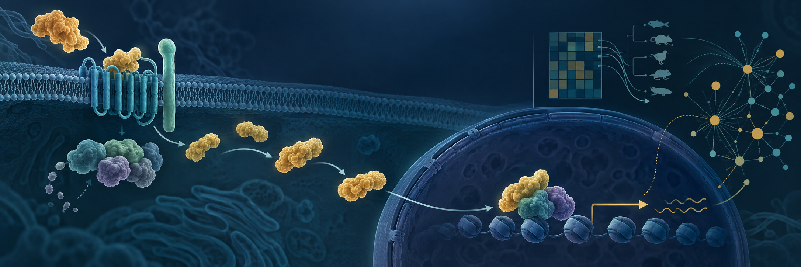
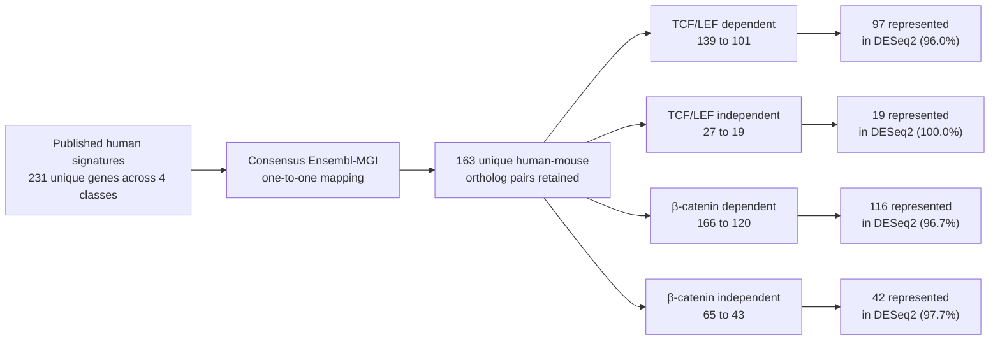
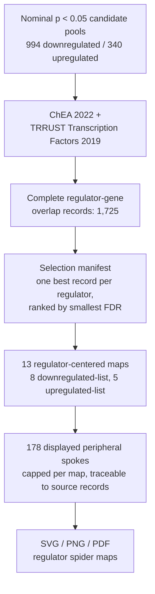
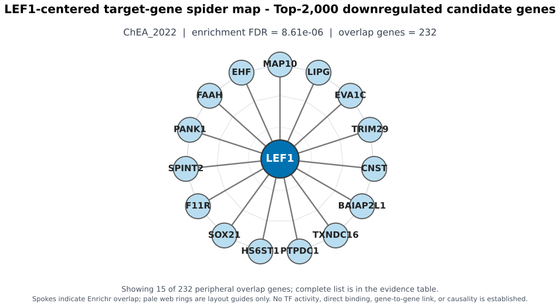
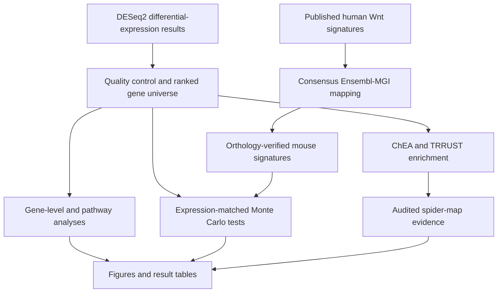

<div align="center">



# Wnt/β-Catenin Transcriptomic Analysis in Mouse Mutant Tissue

**A reproducible, orthology-audited analysis of mutant-versus-control bulk RNA-seq data**

[](https://www.python.org/)
[](https://www.r-project.org/)
[](https://bioconductor.org/packages/DESeq2/)
[](#orthology-verified-wnt-signatures)
[](#ranked-signature-validation)
[](#quality-control-and-reproducibility)
[](#interpretation-boundaries)
[](#license)

### Collaborative research context

[](#collaboration-and-acknowledgments)
[](https://www.adaforsyth.org/)
[](https://www.harvard.edu/)
[](https://www.hsci.harvard.edu/)
[](https://www.northeastern.edu/)

</div>

---

## Overview

This repository evaluates transcriptional changes in mouse mutant tissue with emphasis on:

- epithelial integrity and cell-junction programs;
- craniofacial and skeletal development;
- published Wnt/β-catenin target-gene signatures;
- consensus human-to-mouse orthology;
- transcription-factor target-set enrichment; and
- source-audited regulator-target overlap visualization.

The project is intentionally conservative. High cross-species gene representation is treated as **coverage**, not evidence of pathway activation or repression. Regulator-centered spider-map edges represent database-supported target-set memberships intersecting current-study candidate genes; they do not establish direct binding, regulator activity, regulatory direction, or causality.

## Study design

| Group | Biological replicates |
|---|---:|
| Control | 4 |
| Mutant | 4 |

Canonical differential-expression input:

```text
data/processed/DESeq2_results_RECALCULATE_4control_4mutant-20251023_TM.csv
```

| Measure | Count |
|---|---:|
| Raw rows | 22,444 |
| Rows with usable symbol, fold change, and p-value | 21,730 |
| Unique analyzed gene symbols | 21,715 |

The analysis uses gene identifiers, symbols, normalized abundance, log2 fold changes, and nominal p-values. Project-side gene-level BH values used for plotting are calculated across the complete valid testing universe before gene-symbol deduplication.

## Principal findings

### Differential expression

Using nominal `p < 0.05` and `|log2FoldChange| >= 1`:

| Category | Genes |
|---|---:|
| Upregulated | 84 |
| Downregulated | 661 |
| Total | 745 |

An additional exploratory filter of nominal `p < 0.01` and `|log2FoldChange| > 2` identified 249 genes: 10 upregulated and 239 downregulated.

### Epithelial-junction program

Custom preranked GSEA identified negative enrichment of the exploratory epithelial-junction core set:

| Statistic | Result |
|---|---:|
| NES | approximately −1.61 |
| GSEA FDR q-value | approximately 0.0012 |
| Direction | lower-ranked expression in mutant versus control |

Leading-edge genes included epithelial keratins, desmosomal genes, claudins, and other junction-associated genes.

## Orthology-verified Wnt signatures

Published human Wnt/β-catenin signatures were mapped to mouse using a consensus one-to-one Ensembl-MGI acceptance rule. The finalized audit retained **163 unique human-mouse ortholog pairs from 231 unique published human genes**. Signature classes overlap and their counts must not be summed.

| Published signature | Published | Mapped | Represented in DESeq2 | Coverage |
|---|---:|---:|---:|---:|
| TCF/LEF dependent | 139 | 101 | 97 | 96.0% |
| TCF/LEF independent | 27 | 19 | 19 | 100.0% |
| β-catenin dependent | 166 | 120 | 116 | 96.7% |
| β-catenin independent | 65 | 43 | 42 | 97.7% |



*Signature classes overlap at the gene level, so the per-class counts above are not additive to the 163-pair total.*

<div align="center">


**Figure 1.** Orthology-verified evaluation of published Wnt/β-catenin target-gene signatures.

</div>

### Ranked signature validation

The four orthology-verified signatures were tested using 10,000 expression-matched Monte Carlo simulations with a fixed random seed.

| Signature | Represented | NES | Empirical two-sided p | BH FDR |
|---|---:|---:|---:|---:|
| TCF/LEF independent | 19 | −1.149 | 0.233 | 0.491 |
| β-catenin dependent | 116 | −1.090 | 0.276 | 0.491 |
| β-catenin independent | 42 | −0.853 | 0.368 | 0.491 |
| TCF/LEF dependent | 97 | −0.660 | 0.502 | 0.502 |

All four normalized enrichment scores were negative, but none of the ranked signature tests was statistically significant after BH correction. The minimum **signature-level** FDR was 0.491.

> **Statistical distinction:** `padj_plot` is a gene-level BH-adjusted value used in figure construction. The FDR values above belong to four signature-level Monte Carlo tests. They are different statistical objects.

## Craniofacial and skeletal screen

An ontology-guided framework selected 44 GO terms and a 496-gene candidate universe, of which 453 genes were represented in the RNA-seq analysis. `Bmp6` and `Lama5` passed the project's audit-derived gene-level BH threshold. Canonical Wnt reference genes such as `Axin2`, `Dkk1`, `Nkd1`, `Tcf7`, `Apcdd1`, and `Sp5` were not significant.

## Audited TF target-set analysis

Nominally selected genes (`p < 0.05`, no fold-change cutoff) were separated by direction:

| Candidate set | Genes |
|---|---:|
| Downregulated | 994 |
| Upregulated | 340 |

Target-set enrichment used ChEA 2022 and TRRUST Transcription Factors 2019. The source audit currently contains:

| Audit component | Records |
|---|---:|
| Regulator-centered maps | 13 |
| Complete regulator-gene overlap records | 1,725 |
| Displayed peripheral spokes | 178 |

The displayed spokes are traceable to the enrichment evidence and selection manifest. Term-level adjusted p-values apply to enriched regulator terms, not to individual spokes. Regulator self-overlaps explain the reconciled SP7 and SOX2 count differences, and `RING1B` is retained as the display alias for the source term `RNF2`.



*Every spoke in the figures above traces back through this chain to a specific enrichment record in the selection manifest; term-level FDR values describe the regulator's overall target-set enrichment, not any individual spoke.*

| Downregulated target-set example | Upregulated target-set example |
|---|---|
|  |  |

## TF–Wnt/osteogenesis regulatory-association networks

A complementary pathway-focused analysis intersects direction-specific nominal DEGs with significantly enriched TF target sets and Wnt/osteogenesis annotations.

Two distinct statistical thresholds are used:

- **DEG selection:** nominal `p < 0.05`, without a fold-change cutoff.
- **TF target-set enrichment:** Benjamini–Hochberg **FDR < 0.05**.

These thresholds represent different statistical operations and should not be interpreted as equivalent.

| Network-analysis measure | Result |
|---|---:|
| Unique genes in testing universe | 21,715 |
| Nominal `p < 0.05` genes | 1,334 |
| Downregulated nominal DEGs | 994 |
| Upregulated nominal DEGs | 340 |
| Wnt annotation genes in universe | 412 |
| Osteogenesis annotation genes in universe | 319 |
| Wnt TF–DEG edges plotted | 48 |
| Osteogenesis TF–DEG edges plotted | 23 |
| TFs shared between maps | 2 |

<div align="center">


**Figure 2.** TF target-set programs intersecting downregulated Wnt-associated nominal DEGs.


**Figure 3.** TF target-set programs intersecting upregulated osteogenesis-associated nominal DEGs.

</div>

### Network interpretation

These figures are **regulatory-association networks**, not causal regulatory models.

- Squares represent enriched TF target sets.
- Circles represent pathway-associated nominal DEGs.
- Node size is proportional to network degree.
- TF enrichment must pass BH FDR < 0.05 before inclusion.
- Edges represent TF target-set membership together with pathway overlap.
- Edge width is intentionally constant and does not encode interaction strength.
- Polycomb coloring is a prespecified visual annotation only.

An edge therefore does **not** establish direct TF–DNA binding, protein–protein interaction, regulatory direction, interaction strength, TF activity, or causal regulation in the studied tissue.

The complete reproducibility package is available under `results/tf_networks/`, including TF-enrichment results, edge tables, node statistics, network summaries, and PNG/SVG figures.

## Analysis workflow



### Core scripts

| Script | Purpose |
|---|---|
| `01_parse_degs.py` | Create direction-specific DEG tables |
| `02_volcano_plot.py` | Generate the transcriptome volcano plot |
| `04_wnt_signature_analysis.py` | Evaluate four published Wnt/TCF signatures |
| `05_wnt_ranked_gsea.py` | Run custom Wnt and epithelial preranked GSEA |
| `07_pathway_preranked_gsea.py` | Run GO, Reactome, and KEGG preranked GSEA |
| `11_craniofacial_skeletal_extraction.py` | Build the developmental gene screen |
| `13_upstream_tf_target_enrichment.py` | Run TF target-set enrichment |
| `17_tf_target_deg_spider_maps.py` | Create evidence-linked regulator spider maps |
| `21_wnt_signature_ranked_validation.py` | Run expression-matched Monte Carlo validation |
| `22_verify_human_mouse_orthology.py` | Audit consensus human-mouse orthology |
| `plot_doumpas_nature_style_finalized.py` | Generate the authoritative Wnt signature figure |

## Reproduction

Run all commands from the repository root.

### Environment setup

```bash
python3 -m venv .venv
source .venv/bin/activate
python -m pip install --upgrade pip
python -m pip install -r requirements.txt
```

Fish shell:

```fish
python3 -m venv .venv
source .venv/bin/activate.fish
python -m pip install --upgrade pip
python -m pip install -r requirements.txt
```

### Orthology verification

```bash
python scripts/22_verify_human_mouse_orthology.py \
  --signatures data/reference/Wnt_beta_catenin_LEFTCF_signatures.xlsx \
  --outdir results/wnt_orthology_verification \
  --workers 2 \
  --timeout 90 \
  --retries 5
```

### Ranked Wnt validation

```bash
python scripts/21_wnt_signature_ranked_validation.py \
  --deseq2 data/processed/DESeq2_results_RECALCULATE_4control_4mutant-20251023_TM.csv \
  --signatures data/reference/Wnt_beta_catenin_LEFTCF_signatures.xlsx \
  --ortholog-map data/reference/human_mouse_consensus_one2one.csv \
  --outdir results/wnt_signature_ranked_validation_verified_orthologs \
  --n-sim 10000 \
  --seed 20260917
```

### Final Wnt figure

```bash
python scripts/plot_doumpas_nature_style_finalized.py
```

The production figure must be generated without `--allow-count-mismatch`.

### TF spider maps

```bash
python scripts/17_tf_target_deg_spider_maps.py
```

## Quality control and reproducibility

```bash
python -m pytest -q
git diff --check
```

Current validated test status: **7 passed**.

Reproducibility safeguards include:

- version-controlled scripts and deterministic random seeds;
- predefined orthology count assertions;
- gene-level BH adjustment before symbol deduplication;
- source-level evidence and selection manifests for spider maps;
- SVG, PDF, and 600-dpi PNG figure exports; and
- SHA-256 file-integrity manifests in professor-review packages.

## Repository structure

```text
data/
├── processed/                 # Current-study DESeq2 summary
└── reference/                 # Published signatures and orthology map
figures/                       # Main analysis figures
reports/                       # Reports, manuscripts, and presentations
results/
├── tf_target_spider_maps/     # TF figures, evidence table, and manifest
├── wnt_orthology_verification/
└── wnt_signature_ranked_validation_verified_orthologs/
scripts/                       # Reproducible Python and R scripts
tests/                         # Validation tests
requirements.txt               # Direct dependencies
requirements-lock.txt          # Frozen Python environment
```

## Interpretation boundaries

- Representation means presence in the valid DESeq2 testing universe; it does not indicate significant differential expression.
- High orthology coverage does not establish pathway enrichment.
- The four Wnt signatures overlap and their counts are not additive.
- Negative NES values are exploratory directional tendencies; none of the four signature tests survived BH correction.
- A spider-map spoke represents database-supported target-set membership, not direct TF binding, activity, regulatory direction, or causality.
- Enrichment-term FDR values do not apply to individual regulator-gene edges.
- The study contains four samples per group and may have limited power for modest gene-set effects.
- Independent biological validation remains necessary.

## Collaboration and acknowledgments

This project is being developed by **Md Tariqul Islam**, a graduate researcher in bioinformatics at Northeastern University, in research collaboration with **Professor Wei Hsu and the Wei Hsu laboratory at the ADA Forsyth Institute**. Professor Hsu's broader academic and scientific affiliations include the Harvard research community and the Harvard Stem Cell Institute.

The institutional badges above acknowledge the collaboration and the scientific environment of the project. They do **not** imply that the repository author holds an appointment, degree affiliation, or employment relationship with Harvard University or the Harvard Stem Cell Institute.

## Research integrity and use of generative AI

Generative AI and large language model tools assisted with portions of code drafting, troubleshooting, documentation organization, and language editing. The researcher reviewed the analytical design, executed the code, verified inputs and outputs, inspected the figures, evaluated the biological and statistical interpretations, and retains responsibility for the accuracy and integrity of the work. AI tools did not generate experimental data, determine authorship, or replace scientific judgment.

## Data and privacy

The repository is currently private. It contains a processed differential-expression summary rather than raw FASTQ or alignment files. Authorization should be reconfirmed before changing repository visibility or redistributing processed data, signature workbooks, presentations, or reports.

## Citation

If you use this analysis, cite the repository and the underlying signature study:

> Doumpas, N., Lampart, F., Robinson, M. D., Lentini, A., Nestor, C. E., Cantù, C., & Basler, K. (2019). TCF/LEF dependent and independent transcriptional regulation of Wnt/β-catenin target genes. *The EMBO Journal, 38*, e98873. https://doi.org/10.15252/embj.201798873

## License

No license has been selected. Until a license is added, standard copyright restrictions apply.

---

<div align="center">

**Orthology verified · Source audited · Reproducible · Interpretation aware**


</div>
