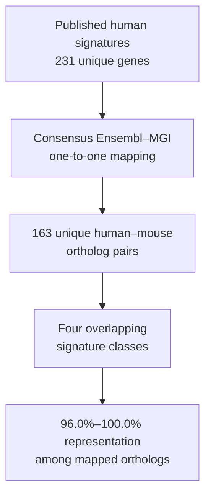
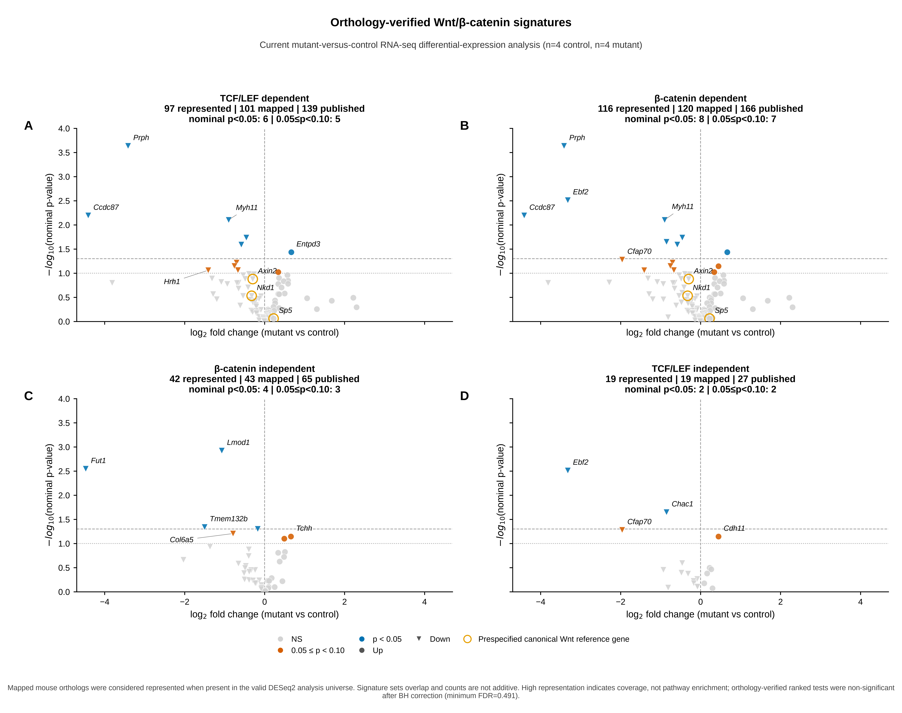
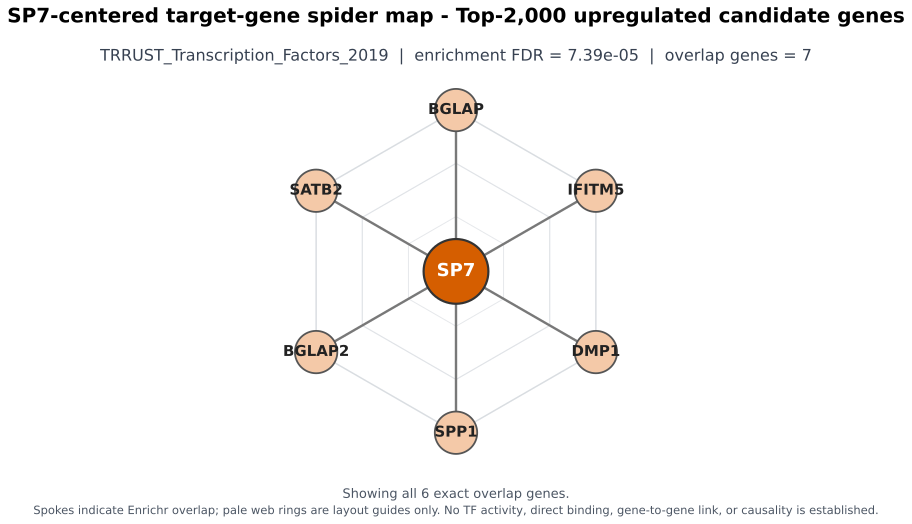
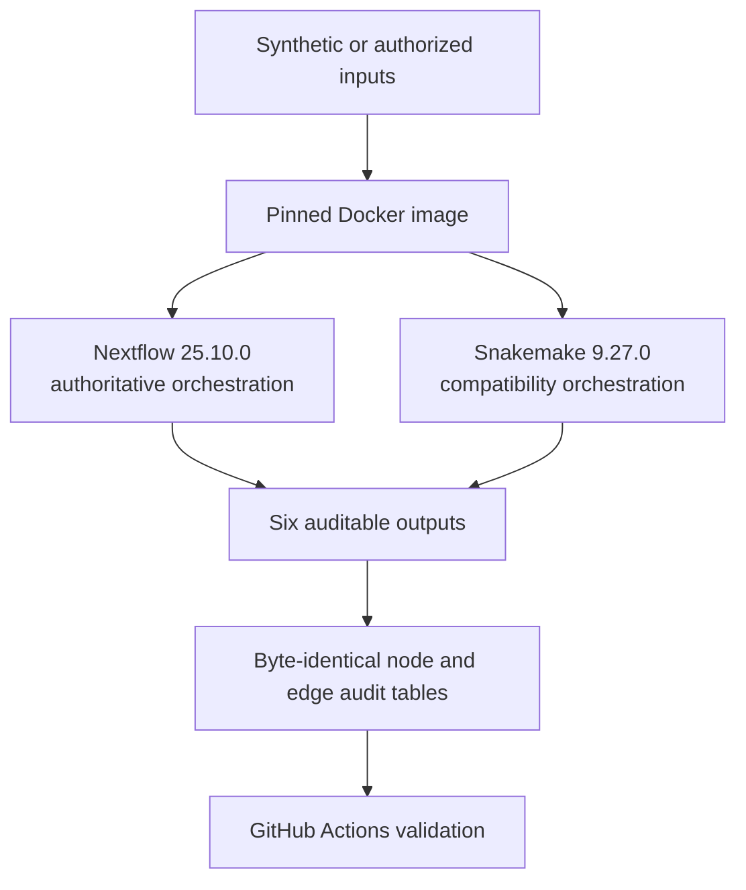

<div align="center">


# Wnt/β-Catenin Transcriptomic Analysis in Mouse Mutant Tissue

**Orthology-audited Wnt-signature analysis, evidence-separated functional networks, and reproducible mutant-versus-control RNA-seq workflows**

[](https://github.com/mtariqi/wnt-beta-catenin-rnaseq-analysis/actions/workflows/reproducibility.yml)
[](https://www.python.org/)
[](https://bioconductor.org/packages/DESeq2/)
[](https://www.nextflow.io/)
[](https://snakemake.github.io/)
[](https://www.docker.com/)
[](#validation-and-continuous-integration)
[](#orthology-verified-wnt-signatures)
[](#interpretation-boundaries)
[](#license)

### Collaborative research context

[](#collaboration-and-acknowledgments)
[](https://www.adaforsyth.org/)
[](https://www.harvard.edu/)
[](https://www.hsci.harvard.edu/)
[](https://www.northeastern.edu/)

</div>

---

## Contents

- [Project overview](#project-overview)
- [Study design and input universe](#study-design-and-input-universe)
- [Principal findings](#principal-findings)
- [Orthology-verified Wnt signatures](#orthology-verified-wnt-signatures)
- [TF and functional-association analyses](#tf-and-functional-association-analyses)
- [Reproducibility architecture](#reproducibility-architecture)
- [Quick start](#quick-start)
- [Running the workflows](#running-the-workflows)
- [Inputs and outputs](#inputs-and-outputs)
- [Validation and continuous integration](#validation-and-continuous-integration)
- [Repository structure](#repository-structure)
- [Interpretation boundaries](#interpretation-boundaries)
- [Data governance](#data-governance)
- [Citation and references](#citation-and-references)
- [Collaboration and acknowledgments](#collaboration-and-acknowledgments)
- [License](#license)

## Project overview

This repository evaluates transcriptional changes in mouse mutant tissue, with emphasis on:

- epithelial integrity and cell-junction programs;
- craniofacial and skeletal development;
- published Wnt/β-catenin target-gene signatures;
- consensus human-to-mouse one-to-one orthology;
- transcription-factor target-set enrichment;
- FunMap, STRING, and curated-literature association evidence; and
- source-audited, reproducible figure generation.

The project deliberately separates four evidence layers:

1. current-study mouse differential expression;
2. consensus human–mouse orthology;
3. imported functional-association evidence; and
4. regulator target-set enrichment and curated literature evidence.

High cross-species representation is interpreted as **coverage**, not pathway enrichment. Network edges are treated as external association evidence and do not establish direct binding, regulator activity, directionality, or causality in the current experiment.

## Study design and input universe

| Group | Biological replicates |
|---|---:|
| Control | 4 |
| Mutant | 4 |

Canonical differential-expression input:

```text
data/processed/DESeq2_results_RECALCULATE_4control_4mutant-20251023_TM.csv
```

| Measure | Count |
|---|---:|
| Raw rows | 22,444 |
| Rows with usable symbol, fold change, and p-value | 21,730 |
| Unique analyzed gene symbols | 21,715 |

Required DESeq2-summary columns include `symbol`, `log2FoldChange`, and `pvalue`. Additional columns such as `gene_id`, `baseMean`, and `padj` are retained when available.

For project-side plotting, Benjamini–Hochberg adjustment is applied across the complete valid gene-level testing universe **before** display-oriented symbol deduplication. Existing DESeq2 `padj` values are retained where present; missing adjusted values are recomputed from valid p-values.

## Principal findings

### Differential expression

Using nominal `p < 0.05` and `|log2FoldChange| >= 1`:

| Category | Genes |
|---|---:|
| Upregulated | 84 |
| Downregulated | 661 |
| Total | 745 |

An exploratory filter of nominal `p < 0.01` and `|log2FoldChange| > 2` identified 249 genes: 10 upregulated and 239 downregulated.

### Epithelial-junction program

Custom preranked analysis identified negative enrichment of an exploratory epithelial-junction core set:

| Statistic | Result |
|---|---:|
| NES | approximately −1.61 |
| GSEA FDR q-value | approximately 0.0012 |
| Direction | lower-ranked expression in mutant versus control |

Leading-edge genes included epithelial keratins, desmosomal genes, claudins, and other junction-associated genes.

### Craniofacial and skeletal screen

An ontology-guided framework selected 44 GO terms and a 496-gene candidate universe, of which 453 genes were represented in the RNA-seq analysis. `Bmp6` and `Lama5` passed the project’s audit-derived gene-level BH threshold. Canonical Wnt reference genes such as `Axin2`, `Dkk1`, `Nkd1`, `Tcf7`, `Apcdd1`, and `Sp5` were not significant.

## Orthology-verified Wnt signatures

Published human Wnt/β-catenin signatures were mapped to mouse using a consensus one-to-one Ensembl–MGI acceptance rule. The finalized audit retained **163 unique human–mouse ortholog pairs from 231 unique published human genes**. Signature classes overlap and their counts must not be summed.

| Published signature | Published | Mapped | Represented in DESeq2 | Coverage |
|---|---:|---:|---:|---:|
| TCF/LEF dependent | 139 | 101 | 97 | 96.0% |
| TCF/LEF independent | 27 | 19 | 19 | 100.0% |
| β-catenin dependent | 166 | 120 | 116 | 96.7% |
| β-catenin independent | 65 | 43 | 42 | 97.7% |



<div align="center">



**Figure 1.** Orthology-verified evaluation of published Wnt/β-catenin target-gene signatures.

</div>

### Ranked signature validation

The four orthology-verified signatures were evaluated using 10,000 expression-matched Monte Carlo simulations with a fixed random seed.

| Signature | Represented | NES | Empirical two-sided p | BH FDR |
|---|---:|---:|---:|---:|
| TCF/LEF independent | 19 | −1.149 | 0.233 | 0.491 |
| β-catenin dependent | 116 | −1.090 | 0.276 | 0.491 |
| β-catenin independent | 42 | −0.853 | 0.368 | 0.491 |
| TCF/LEF dependent | 97 | −0.660 | 0.502 | 0.502 |

All four normalized enrichment scores were negative, but none of the ranked signature tests remained statistically significant after BH correction. The minimum **signature-level** FDR was 0.491.

> **Statistical distinction:** `padj_plot` is a gene-level BH-adjusted value used for displayed gene-level inference. The FDR values in the table above belong to four signature-level Monte Carlo tests. They are different statistical objects.

## TF and functional-association analyses

### Audited TF target-set analysis

Nominally selected genes (`p < 0.05`, no fold-change cutoff) were separated by direction:

| Candidate set | Genes |
|---|---:|
| Downregulated | 994 |
| Upregulated | 340 |

Target-set enrichment used ChEA 2022 and TRRUST Transcription Factors 2019.

| Audit component | Records |
|---|---:|
| Regulator-centered maps | 13 |
| Complete regulator–gene overlap records | 1,725 |
| Displayed peripheral spokes | 178 |

Displayed spokes are traceable to the source enrichment evidence and selection manifest. Term-level adjusted p-values apply to complete regulator terms, not individual spokes. Regulator self-overlaps explain the reconciled SP7 and SOX2 count differences. `RING1B` is retained as a display alias for the source term `RNF2`.

| Downregulated target-set example | Upregulated target-set example |
|---|---|
|  |  |

### TF–Wnt and osteogenesis association networks

The pathway-focused analysis intersects direction-specific nominal DEGs with BH-significant TF target sets and Wnt/osteogenesis annotations.

| Network-analysis measure | Result |
|---|---:|
| Unique genes in testing universe | 21,715 |
| Nominal `p < 0.05` genes | 1,334 |
| Downregulated nominal DEGs | 994 |
| Upregulated nominal DEGs | 340 |
| Wnt annotation genes in universe | 412 |
| Osteogenesis annotation genes in universe | 319 |
| Wnt TF–DEG edges plotted | 48 |
| Osteogenesis TF–DEG edges plotted | 23 |
| TFs shared between maps | 2 |

Edges represent enriched TF target-set membership together with pathway overlap. Edge width is intentionally constant and does not encode evidence strength.

### Evidence-separated FunMap overlay

The auditable Wnt/PCP pipeline reads genuine imported scores and preserves evidence provenance:

| Code | Evidence layer | Interpretation |
|---|---|---|
| `F` | FunMap | Predicted functional association; score is not a p-value |
| `S` | STRING | Functional-association confidence; score is not a p-value |
| `L` | Curated literature | Manually supplied claim with traceable citation |
| Multiple | More than one layer | Convergent external association evidence |

FunMap scores are never reconstructed from DESeq2 summary statistics. Current-study tissue specificity applies to node differential expression, not imported external edges.

## Reproducibility architecture

Nextflow plus Docker is the authoritative portable workflow. Snakemake provides an independently tested orchestration layer with the same six-output contract.



Validated environment components:

| Component | Version or artifact |
|---|---|
| Host Python | 3.12.3 |
| Docker base | `python:3.12.3-slim-bookworm` |
| Nextflow | 25.10.0 |
| Java | 21 |
| Snakemake | 9.27.0 |
| Snakemake environment Python | 3.12.14 |
| Analysis dependency lock | `requirements-workflow-lock.txt` |
| Snakemake explicit Linux lock | `workflow/snakemake/conda-linux-64.lock` |

## Quick start

### Prerequisites

- Git
- Docker
- Java 21 and Nextflow 25.10.0 for the authoritative workflow
- Mamba/Conda for the Snakemake compatibility workflow

Clone the repository and enter it:

```bash
git clone https://github.com/mtariqi/wnt-beta-catenin-rnaseq-analysis.git
cd wnt-beta-catenin-rnaseq-analysis
```

Build the locked analysis image:

```bash
docker build \
  -f containers/Dockerfile \
  -t wnt-rnaseq-analysis:workflow \
  .
```

Run the portable container tests:

```bash
docker run --rm \
  wnt-rnaseq-analysis:workflow \
  python -m pytest -q \
  tests/workflow/test_wntpcp_funmap_pipeline.py
```

Expected result: **2 passed**.

## Running the workflows

### Nextflow synthetic smoke test

The default Nextflow parameters use only non-sensitive synthetic fixtures.

```bash
mkdir -p results/nextflow_metadata
nextflow run main.nf -profile docker
```

Resume a prior run:

```bash
nextflow run main.nf -profile docker -resume
```

Expected analysis outputs are published to `results/nextflow_smoke/`; execution metadata are written to `results/nextflow_metadata/`.

### Nextflow with authorized study inputs

Provide every input explicitly rather than changing the committed smoke-test defaults:

```bash
mkdir -p results/nextflow_metadata

nextflow run main.nf \
  -profile docker \
  --deseq /path/to/authorized_deseq_results.csv \
  --orthology /path/to/human_mouse_consensus_one2one.csv \
  --funmap /path/to/official_or_documented_funmap_scores.tsv \
  --string_file /path/to/string_edges.tsv \
  --literature /path/to/curated_literature_edges.csv \
  --gene_file /path/to/mouse_gene_symbols.txt \
  --string_species mouse \
  --funmap_score_min 0.50 \
  --string_score_min 0.70 \
  --outdir results/wntpcp_funmap \
  --prefix wntpcp_funmap_network \
  --title "Wnt/PCP functional-association network"
```

### Snakemake synthetic smoke test

Create the pinned environment:

```bash
mamba env create \
  --file workflow/snakemake/environment.yml
```

Run the workflow:

```bash
mamba run \
  --name wnt-snakemake \
  snakemake \
  --snakefile workflow/snakemake/Snakefile \
  --configfile workflow/snakemake/config.yaml \
  --cores 1 \
  --printshellcmds
```

For authorized inputs, copy `workflow/snakemake/config.yaml`, edit only the copied paths and parameters, and pass the copy using `--configfile`.

### Direct Python execution

```bash
python scripts/wntpcp_funmap_pipeline.py \
  --deseq /path/to/deseq.csv \
  --orthology /path/to/orthology.csv \
  --funmap /path/to/funmap.tsv \
  --string /path/to/string.tsv \
  --string-species mouse \
  --literature /path/to/literature.csv \
  --gene-file /path/to/genes.txt \
  --strict-orthology \
  --funmap-score-min 0.50 \
  --string-score-min 0.70 \
  --outdir results/wntpcp_funmap
```

## Inputs and outputs

### Input contracts

| Input | Required fields | Notes |
|---|---|---|
| DESeq2 summary | `symbol`, `log2FoldChange`, `pvalue` | Mouse gene symbols; `padj` and `baseMean` optional |
| Orthology map | `human_symbol`, `mouse_symbol` | Must remain one-to-one after normalization |
| FunMap table | `gene1`, `gene2`, `score` | Alternative documented names accepted by the loader |
| STRING table | endpoint columns plus `score` or `combined_score` | Mouse or human symbols; human endpoints are orthology-mapped |
| Literature table | `source`, `target`, `citation` | `species` and `relationship` recommended |
| Gene panel | one mouse symbol per line | Overrides the default Wnt/PCP panel |

### Six-output contract

For prefix `wntpcp_funmap_network`, both workflow engines generate:

```text
wntpcp_funmap_network.png
wntpcp_funmap_network.pdf
wntpcp_funmap_network.svg
wntpcp_funmap_network_edge_audit.csv
wntpcp_funmap_network_node_audit.csv
wntpcp_funmap_network_run_provenance.json
```

The provenance JSON records:

- UTC generation time;
- executed command;
- Python and package versions;
- SHA-256 hashes of inputs;
- analysis parameters;
- DESeq2 testing-universe metadata;
- orthology mapping status;
- FunMap source format and score interpretation;
- candidate/displayed edge counts; and
- interpretation constraints.

## Validation and continuous integration

Local validation:

```bash
python -m pytest -q
git diff --check
```

Current validated status: **11 passed**.

The portable Docker image runs two workflow-specific tests without incorporating the confidential study dataset or historical validated outputs.

GitHub Actions performs:

1. locked Python installation and regression testing;
2. Docker image construction;
3. confirmation that `data/processed/` is absent from the image;
4. portable tests inside Docker;
5. Nextflow synthetic execution;
6. Snakemake synthetic execution;
7. byte-level comparison of node and edge audit tables; and
8. cross-engine provenance-summary validation.

The synthetic baseline must reproduce:

| Assertion | Expected value |
|---|---:|
| Candidate edges | 3 |
| Displayed edges | 3 |
| Represented nodes | 3 |
| Unmapped requested genes | 0 |
| Evidence layers | `FunMap`, `FunMap+STRING`, `literature` |

## Repository structure

```text
.
├── .github/workflows/
│   ├── pylint.yml
│   └── reproducibility.yml
├── config/
│   ├── genes_wntpcp_default.txt
│   └── templates/
├── containers/
│   └── Dockerfile
├── data/
│   ├── processed/                  # Authorized current-study summary data
│   ├── public_gene_sets/           # Versioned GMT libraries and checksums
│   └── reference/                  # Signature and orthology references
├── docs/methods/
├── results/                        # Analysis outputs and audits
├── scripts/                        # Python and R analysis programs
├── tests/
│   ├── fixtures/wntpcp/            # Non-sensitive smoke-test inputs
│   └── workflow/
├── workflow/
│   ├── modules/wntpcp_funmap.nf
│   └── snakemake/
├── main.nf
├── nextflow.config
├── requirements.txt
├── requirements-lock.txt
├── requirements-workflow.txt
└── requirements-workflow-lock.txt
```

Core method documentation:

- `docs/methods/WNTPCP_FUNMAP_PIPELINE.md`
- `docs/methods/FUNMAP_SOURCE_REFERENCES.md`
- `data/public_gene_sets/README.md`

## Interpretation boundaries

- Representation means presence in the valid DESeq2 testing universe; it does not indicate significant differential expression.
- High orthology coverage does not establish pathway enrichment.
- The four Wnt signatures overlap and their counts are not additive.
- Negative NES values are exploratory directional tendencies; none of the four orthology-verified signature tests survived BH correction.
- The minimum signature-level FDR of 0.491 is not a gene-level DESeq2 FDR.
- A TF spider-map spoke represents database-supported target-set overlap, not direct binding, activity, regulatory direction, or causality.
- Enrichment-term FDR values do not apply to individual regulator–gene spokes.
- FunMap and STRING scores are functional-association scores, not p-values.
- Imported external edges are not tissue-specific merely because current-study DESeq2 values are overlaid on their nodes.
- The study contains four samples per group and may have limited power for modest gene-set effects.
- Independent biological validation remains necessary.

## Data governance

The repository is currently private. Raw FASTQ and alignment files are not part of this repository. The current-study differential-expression summary and other controlled research artifacts must not be redistributed without authorization.

Safeguards include:

- `data/processed/` excluded from the Docker build context;
- current-study DESeq2 summaries excluded from portable workflow commits;
- synthetic fixtures used by CI;
- generated professor packages and ZIP archives ignored by Git;
- input hashes recorded in provenance files; and
- repository visibility and sharing permissions reviewed before release.

## Research integrity and use of generative AI

Generative-AI and large-language-model tools assisted with portions of code drafting, troubleshooting, documentation organization, and language editing. The researcher reviewed the analytical design, executed the code, verified inputs and outputs, inspected figures, evaluated biological and statistical interpretations, and retains responsibility for the accuracy and integrity of the work. AI tools did not generate experimental data, determine authorship, or replace scientific judgment.

## Citation and references

### Citing this repository

No Zenodo DOI has been assigned yet. Until a versioned archival release is created, cite the repository URL, commit identifier, and access date. After Zenodo deposition, replace this instruction with the archived release DOI and add a DOI badge.

Suggested interim format:

> Islam, M. T. (2026). *Wnt/β-catenin transcriptomic analysis in mouse mutant tissue* [Computer software]. GitHub. https://github.com/mtariqi/wnt-beta-catenin-rnaseq-analysis

### Key references

Doumpas, N., Lampart, F., Robinson, M. D., Lentini, A., Nestor, C. E., Cantù, C., & Basler, K. (2019). TCF/LEF dependent and independent transcriptional regulation of Wnt/β-catenin target genes. *The EMBO Journal, 38*, e98873. https://doi.org/10.15252/embj.201798873

Di Tommaso, P., Chatzou, M., Floden, E. W., Barja, P. P., Palumbo, E., & Notredame, C. (2017). Nextflow enables reproducible computational workflows. *Nature Biotechnology, 35*, 316–319. https://doi.org/10.1038/nbt.3820

Köster, J., & Rahmann, S. (2012). Snakemake—a scalable bioinformatics workflow engine. *Bioinformatics, 28*(19), 2520–2522. https://doi.org/10.1093/bioinformatics/bts480

Love, M. I., Huber, W., & Anders, S. (2014). Moderated estimation of fold change and dispersion for RNA-seq data with DESeq2. *Genome Biology, 15*, 550. https://doi.org/10.1186/s13059-014-0550-8

Database- and resource-specific references for FunMap, STRING, ChEA, TRRUST, Ensembl, MGI, GO, and WikiPathways are maintained in the method documentation and should accompany analyses using those evidence layers.

## Collaboration and acknowledgments

This project is developed by **Md Tariqul Islam**, a graduate researcher in bioinformatics at Northeastern University, in research collaboration with **Professor Wei Hsu and the Wei Hsu laboratory at the ADA Forsyth Institute**. Professor Hsu’s broader academic and scientific affiliations include the Harvard research community and the Harvard Stem Cell Institute.

The institutional badges acknowledge the collaboration and scientific context. They do **not** imply that the repository author holds an appointment, degree affiliation, endorsement, or employment relationship with Harvard University or the Harvard Stem Cell Institute.

## License

No software license has been selected. Until a license is added, standard copyright restrictions apply; public visibility alone does not grant permission to reuse, modify, or redistribute the code or data.

---

<div align="center">

**Orthology audited · Evidence separated · Containerized · Workflow tested · Interpretation aware**

</div>
